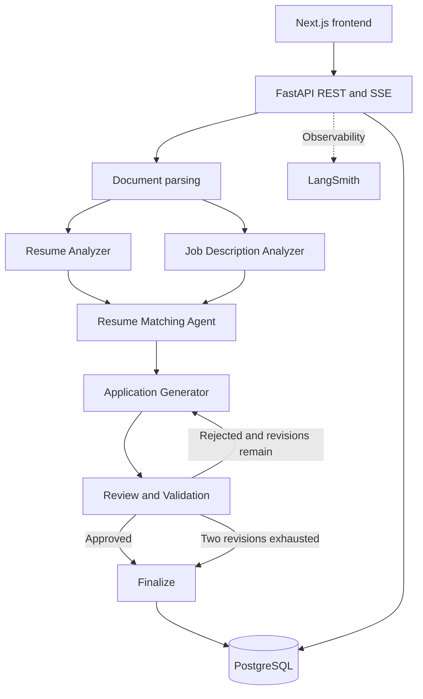

# CareerPilot AI

An evidence-based job application and placement assistant. Upload a PDF or DOCX resume, provide a job description, and receive structured analysis, compatibility scoring, skill gaps, application drafts, interview questions and a reviewed report.

[Open the live application](https://careerpilot-ai-aat.vercel.app). The Next.js frontend runs on Vercel, the FastAPI backend runs on AWS EC2 with HTTPS, and PostgreSQL is hosted on Neon. The voice interview coach uses GPT-4o mini for questions and feedback, local faster-whisper for transcription, and browser speech synthesis for spoken questions.

The interface uses a black-and-white palette, serif display typography, restrained sans-serif body text and monospace labels. The dashboard contains real saved records, not seeded success numbers.

## Architecture

Next.js + React + TypeScript + Tailwind communicate directly with one FastAPI backend. FastAPI owns parsing, five LangGraph agents, OpenAI integration, PostgreSQL persistence, history and PDF generation. There are no Next.js API routes or server actions.



## Start the prepared local demo

```powershell
cd D:\gen_ai_aat
.\start.ps1
```

Then open [CareerPilot AI](http://localhost:3000). The prepared workspace uses portable PostgreSQL on **55432**, with matching local environment configuration. Dependencies are installed. Add your own API keys only when switching to live mode; use `.\start.ps1 -Restart` after backend configuration changes.

## Start here

Read [Windows setup](docs/SETUP.md), then [demo script](docs/DEMO.md). The separate [presentation guide](docs/PRESENTATION_GUIDE.md) explains the project, every agent, scoring, settings and likely viva questions in simple terms. A printable PDF is generated alongside it.

Prerequisites: Python 3.11+, Node.js 20.9+ (Node 22 or 24 recommended), PostgreSQL 17 or Docker Desktop, and a current browser. API keys are unnecessary for offline mock mode.

```powershell
cd D:\gen_ai_aat
python -m venv .venv
.\.venv\Scripts\Activate.ps1
python -m pip install -r backend\requirements.txt
Copy-Item backend\.env.example backend\.env
Copy-Item frontend\.env.example frontend\.env.local
npm.cmd install --prefix frontend
docker compose up -d postgres
cd backend
python -m alembic upgrade head
python -m uvicorn app.main:app --reload --host 127.0.0.1 --port 8000
```

In another terminal:

```powershell
cd D:\gen_ai_aat\frontend
npm.cmd run dev
```

Open [CareerPilot](http://localhost:3000), [API docs](http://localhost:8000/docs), and [health](http://localhost:8000/api/v1/health). If Python resolves to the Windows Store stub, install Python or use the working interpreter recorded in `docs/VERIFICATION.md`.

## Code formatting and connection settings

The source uses Prettier for TypeScript, JSX, CSS and frontend configuration, and Ruff for Python. VS Code workspace settings enable format on save with the recommended Prettier and Ruff extensions.

```powershell
npm.cmd run format --prefix frontend
.\.venv\Scripts\python.exe -m ruff format backend
```

Read [Environment values and connections](docs/ENVIRONMENT_AND_CONNECTIONS.md) for every `.env` variable, LangSmith setup and Neon PostgreSQL connection strings, including the distinction between this app's SQLAlchemy driver and Prisma.

## Modes

- `LLM_MODE=mock`: real LangGraph execution with deterministic extraction, matching, templates and rule-based review. This is explicitly labeled offline output, not OpenAI reasoning. Parsing, scores, history and reports still operate.
- `LLM_MODE=live`: all five specialists use `ChatOpenAI` with Pydantic structured output. `OPENAI_API_KEY` and `OPENAI_MODEL` must be set. No implicit fallback from a failed live request to offline results.

See [OpenAI structured outputs](https://developers.openai.com/api/docs/guides/structured-outputs) for the output contract. Schema conformity does not guarantee factual correctness; the reviewer and human inspection remain necessary.

## Scoring

Mandatory requirements 70%, preferred requirements 20%, experience/responsibilities 10%. Each requirement earns: direct 1, related 0.5, partial 0.25, missing/unknown 0. Empty categories are excluded and active weights normalized. No extracted requirements means a null score, not an invented percentage. Mandatory education, certifications and eligibility are included when identified. Every credited requirement needs resume evidence. See [architecture](docs/ARCHITECTURE.md) for a numerical example.

## Workspace

```text
frontend/src/app/          Pages and styles
frontend/src/components/  Shared layout, widgets and agent monitor
frontend/src/lib/api.ts   All browser API communication
backend/app/api/          REST endpoints
backend/app/agents/       Exactly five specialist modules
backend/app/graph/        Typed state, parallel execution and revision routing
backend/app/tools/        Parsing, matching and scoring
backend/app/database/     SQLAlchemy models and sessions
backend/app/services/     LLM, orchestration service, persistence and PDF reports
backend/alembic/          PostgreSQL migrations
backend/tests/            Unit, integration and evaluation checks
backend/scripts/          Demo fixtures and LangSmith evaluation commands
docs/                     Setup, architecture, testing, demo and presentation guide
```

## Verification

```powershell
cd backend
..\.venv\Scripts\python.exe -m pytest -v
..\.venv\Scripts\python.exe -m pytest --cov=app --cov-report=term-missing
..\.venv\Scripts\python.exe -m scripts.run_langsmith_evaluation --local
cd ..\frontend
npm.cmd run typecheck
npm.cmd run build
```

Database integration uses **PostgreSQL only**, selected with `TEST_DATABASE_URL`. Without that variable the real database test is skipped; the rest still runs without API credentials. Results from this implementation session are in `docs/VERIFICATION.md`.

## Observability and evaluation

LangGraph and LangChain produce real nested traces when `LANGSMITH_TRACING=true` and a LangSmith key is configured. Inputs/outputs are hidden by default to reduce resume exposure. Ten synthetic cases evaluate extraction, requirement coverage, evidence grounding, arithmetic, score ranges, review recovery and workflow completion. Cloud dataset creation and experiments are documented in [LangSmith setup](docs/LANGSMITH.md).

## Privacy and limitations

Uploaded binaries stay in memory. Extracted resume text is persisted because original evidence is needed for section regeneration and review. Profiles, job descriptions and generated material are also saved. Deleting an analysis removes all linked records. Treat this local single-user app as containing personal data; it has no authentication or tenant isolation.

Live mode sends document text to OpenAI. Tracing is off by default. Prompt boundaries and schema/evidence validation reduce injection risk, but do not make LLMs immune to malicious documents. The reviewer is not a proof of truth. Offline vocabulary is intentionally finite and can miss nuance, negate evidence incorrectly or fail to interpret unusual layouts. Scanned PDFs require external OCR. No automated emailing, applications or job scraping is included.

Before public deployment add authentication, per-user authorization, HTTPS, managed secrets, API and upload rate limits, a reverse-proxy body limit, backups, retention controls, monitoring and a durable worker strategy for long analyses. SSE workflows are tied to a running request; cancellation stops in-progress work, and they do not resume after server restart. History is capped at 200 recent rows. Matching weights are heuristic, not trained or scientifically calibrated. Related/partial credits are adjustable only in the centralized scoring module.

## Deployment and future work

Run PostgreSQL using `compose.yaml` or a managed instance, apply Alembic migrations, run FastAPI with Uvicorn, build Next.js and run `npm start`. Configure the public FastAPI URL at frontend build time. The two apps are deployed separately; Next.js remains a frontend. Use explicit allowed frontend origins in backend CORS configuration. Docker is optional and only supplies PostgreSQL here. Do not use the local sample database password in production.

Future improvements: authenticated accounts, encrypted retention policies, broader skill ontologies, annotated evaluation data, OCR, durable queues/checkpoints, richer section regeneration and human review workflows.

## Voice interview coach

Open **Interview prep** on a saved analysis for a resume-based voice interview and a written report. See [Voice interview setup](docs/VOICE_INTERVIEW.md) for microphone, Whisper, and database setup.
